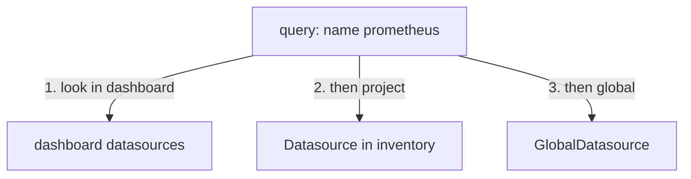

# Datasources, Scopes And Overrides

A team that adds a dashboard should not have to know the address of the company Prometheus. A team whose logs live behind a different gateway should be able to use its own Loki without breaking anyone else. Perses solves both problems with **scopes**: the same kind of datasource can be defined for every project, for one project, or for one dashboard. This part shows the three scopes, how a query picks a datasource, and what happens when two datasources share a name.

## Three places a datasource can live

A datasource is a Perses resource. Its `spec.plugin` names the backend type, for example `PrometheusDatasource`, and holds the settings that type needs. Where you store the resource decides who can use it:

| Scope | Resource kind | Who can use it |
| --- | --- | --- |
| Global | `GlobalDatasource` | Every dashboard in every project |
| Project | `Datasource` with `metadata.project` | Every dashboard in that project |
| Dashboard | An entry in the dashboard's `spec.datasources` | Only that dashboard |

The playground already holds four global datasources. List them with `percli`; `gdts` is the short name `percli` accepts for `globaldatasource`:

<!-- astrona:playground:renew -->

```sh
percli get gdts
```

You should see `prometheus`, `loki`, `tempo` and `pyroscope`. Now look at the full definition of one of them:

```sh
percli describe gdts prometheus
```

The `spec` has two fields that matter in this part. `default: true` marks it as the default datasource of its kind. `plugin.kind: PrometheusDatasource` is its kind, and `plugin.spec.proxy.spec.url` is the address the Perses server forwards queries to: `http://prometheus.observability:9090`, an address inside the cluster.

## How a query picks its datasource

A query in a panel can name a datasource, or it can name only a kind. The `datasource` field of a Prometheus query is an object with `kind` and an optional `name`:

```yaml
datasource:
  kind: PrometheusDatasource
  name: prometheus
```

When `name` is set, Perses looks for a datasource with that name. When `name` is missing, Perses uses the **default** datasource of that kind: the one with `default: true`. A query with no `datasource` field at all also uses the default of the kind its plugin needs. That is why most panels in this course do not name a datasource: the global defaults are enough.

## The smallest scope wins

Two datasources may have the same name at different scopes. Then Perses picks the one with the **smallest** scope: a dashboard datasource wins over a project `Datasource`, which wins over a `GlobalDatasource`. This rule lets one project override a shared datasource without changing it for anyone else.



The diagram shows the order in which Perses looks for a datasource named `prometheus`; it uses the first match.

You can see the rule at work with a project datasource. Save this as `datasource-metrics.yaml`; it is a second, non-default Prometheus datasource that only the project `inventory` can use:

```yaml
kind: Datasource
metadata:
  name: metrics
  project: inventory
spec:
  default: false
  plugin:
    kind: PrometheusDatasource
    spec:
      proxy:
        kind: HTTPProxy
        spec:
          url: http://prometheus.observability:9090
```

Apply it:

```sh
percli apply -f datasource-metrics.yaml
```

Then check the result. `dts` is the short name for a project `Datasource`, and it lists the datasources of the project you selected with `percli project`:

```sh
percli get dts
```

The list holds `metrics`, and only `metrics`. Global datasources do not appear in a project list, even though every project can use them. A dashboard in `inventory` can now pick `metrics` by name; a dashboard in another project cannot, because the resource lives in `inventory`.

If you had named this resource `prometheus` instead, every dashboard of `inventory` that asks for `prometheus` would now use the project one, while dashboards in other projects would keep the global one. That override is exactly what the graded lab asks you to build for Loki.

## Default datasources and their pitfalls

The `default` flag is per kind and per scope. One default `PrometheusDatasource` and one default `LokiDatasource` can live side by side, because they are different kinds. Set `default: true` on more than one datasource of the same kind and scope, and you can no longer tell from the resources which one an unnamed query will use, so keep one default per kind.

You now know where a datasource can live, how a query names one, and which one wins when names clash. What you have not seen yet is what the Perses server does with the query once it has picked the datasource. That is the job of the proxy.

## Common pitfalls

> [!WARNING]
> - **Looking for a global datasource in `percli get dts`.** Project lists show only project resources. Use `percli get gdts` for global ones.
> - **Changing a `GlobalDatasource` to fix one project.** Every project uses it. Create a project `Datasource` with the same name instead, and only that project changes.
> - **Two defaults of one kind.** A query without a name then has no single answer. Keep one `default: true` per kind and scope.
> - **Expecting a name to work across projects.** A project `Datasource` is invisible to dashboards in other projects.
