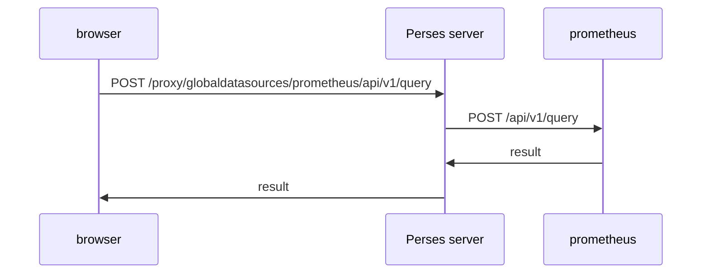

# The Perses Proxy And Allowed Endpoints

Your browser cannot reach `http://prometheus.observability:9090`; that name only exists inside the cluster. Yet a Perses dashboard in your browser shows Prometheus data. The reason is the **proxy**: the Perses server receives every query from the browser and forwards it to the backend on the browser's behalf. This part follows one query through the proxy, calls the proxy yourself, and limits what it forwards.

## One query, two hops

A datasource with a `proxy` block makes the Perses server the middle step. The browser sends the query to a path on the Perses server; the Perses server adds the backend address, and the credentials if there are any, and sends the request on.



The diagram shows the two hops: the browser only ever talks to Perses, and only the Perses server talks to Prometheus.

The proxy path depends on the scope of the datasource. The part after the datasource name is the backend's own path:

| Scope | Proxy path |
| --- | --- |
| Global | `/proxy/globaldatasources/<name>/<backend path>` |
| Project | `/proxy/projects/<project>/datasources/<name>/<backend path>` |
| Dashboard | `/proxy/projects/<project>/dashboards/<dashboard>/datasources/<name>/<backend path>` |

The other choice is `directUrl` instead of `proxy`. Then the browser calls the backend address itself. That only works when the browser can reach the backend and the backend allows calls from the Perses page, so this course always uses the proxy.

## Calling the proxy yourself

You can send the same request the browser sends. Make sure the port-forward is running, then ask Prometheus, through the global datasource `prometheus`, how many series the metric `up` has:

<!-- astrona:playground:renew -->

```sh
curl -s http://perses.localtest.me:8080/proxy/globaldatasources/prometheus/api/v1/query \
  --data-urlencode 'query=up' | jq '.data.result | length'
```

The answer is a number of at least one: the Prometheus server scrapes itself, so `up` always has a series. The `curl` request went to Perses on your machine, and the Perses server forwarded it inside the cluster. You never used the Prometheus address.

The same works for a project datasource. The project datasource `metrics` points at the same Prometheus, so this request gives the same kind of answer:

```sh
curl -s http://perses.localtest.me:8080/proxy/projects/inventory/datasources/metrics/api/v1/query \
  --data-urlencode 'query=up' | jq '.data.result | length'
```

If you did not create `metrics` in the playground, create the `Datasource` named `metrics` in the project `inventory` first, with the same Prometheus URL as the global one.

## Limiting what the proxy forwards

Without limits, the proxy forwards any path to the backend: queries, but also administration endpoints the backend may expose. The `allowedEndpoints` list closes that gap. Each entry is a pair of an HTTP method and an `endpointPattern`, a regular expression for the path. When the list is set, the proxy forwards only requests that match an entry and refuses the rest.

The global `prometheus` datasource already has such a list. Look at it:

```sh
percli describe gdts prometheus -o json | jq '.spec.plugin.spec.proxy.spec.allowedEndpoints'
```

The list holds the paths the Prometheus plugin needs: `POST /api/v1/query`, `POST /api/v1/query_range`, `POST /api/v1/labels`, `POST /api/v1/series`, `GET /api/v1/metadata` and `GET /api/v1/label/([a-zA-Z0-9_-]+)/values`. Now ask for a path that is not on the list, the build information page, and print only the HTTP status code:

```sh
curl -s -o /dev/null -w '%{http_code}\n' \
  http://perses.localtest.me:8080/proxy/globaldatasources/prometheus/api/v1/status/buildinfo
```

The status is not `200`: the Perses server refused the request before it reached Prometheus. Send the same path through the project datasource `metrics`, which has no `allowedEndpoints`, and the status is `200`, because Perses forwards everything for it. The two datasources reach the same backend; only their proxy settings differ.

## Who answered: Perses or the backend?

An error through the proxy can come from two places, and the fix depends on which one. The global `loki` datasource shows the difference. It points at `loki-gateway`, which asks for a password, and it sends none. Ask it for the list of labels:

```sh
curl -s -o /dev/null -w '%{http_code}\n' \
  http://perses.localtest.me:8080/proxy/globaldatasources/loki/loki/api/v1/labels
```

The status is `401`. This path is on the Loki datasource's `allowedEndpoints` list, so the Perses server forwarded it; the gateway refused it, because there were no credentials. A refusal by the proxy and a refusal by the backend look alike in a panel. With `curl` and the status code you can tell them apart, and with `percli describe` you can see whether the path is on the list.

You now know how a query reaches its backend and how to stop it from reaching anything else. The open question is the `401`: the gateway wants a user and a password, and they should not sit in plain text in a datasource.

## Common pitfalls

> [!WARNING]
> - **Testing the backend address from your machine.** `http://prometheus.observability:9090` only exists inside the cluster. Test through the proxy path on `perses.localtest.me`.
> - **Forgetting the backend path.** The proxy path ends with the backend's own path: `.../datasources/loki/loki/api/v1/labels`, with `loki` twice.
> - **Removing `allowedEndpoints` to make an error go away.** The proxy then forwards everything. Add the one path the plugin needs instead.
> - **Blaming the backend for a refusal.** Check the list first: a path missing from `allowedEndpoints` never reaches the backend.
