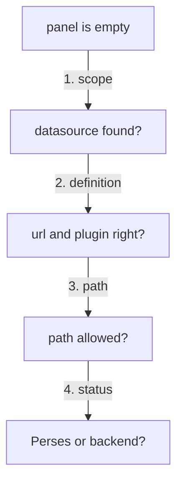

# Find Out Why A Datasource Fails

A panel that shows nothing gives you no error text, and that makes it tempting to change settings at random. A fixed order of checks is faster, because each check removes one possible cause for good. This part gives the order and runs it against two broken datasources.

## The order of checks

There are four questions. The first two read Perses resources, and the last two send a request.



The diagram shows the order: find the datasource, read its definition, test the path, then read the status code.

The first check is the scope. Read the panel query and note the datasource `kind` and `name`, or the lack of a name. Then look in the three places in order: the dashboard, the project, the global list. If the name is nowhere, the panel has nothing to query.

The second check is the definition. Read the datasource with `percli describe` and look at the plugin `kind`, the `url` (including the port) and the `allowedEndpoints` list.

## Run the checks on a broken datasource

Save this as `datasource-prometheus-broken.yaml`. It has a wrong port on purpose:

<!-- astrona:playground:renew -->

```yaml
kind: Datasource
metadata:
  name: prometheus-broken
  project: inventory
spec:
  default: false
  plugin:
    kind: PrometheusDatasource
    spec:
      proxy:
        kind: HTTPProxy
        spec:
          url: http://prometheus.observability:9999
```

Apply it:

```sh
percli apply -f datasource-prometheus-broken.yaml
```

Perses accepts the resource, because a wrong port is valid text. Check 2 shows nothing wrong at a glance either. Check 3 and check 4 expose it. Send a query and print only the status code:

```sh
curl -s -o /dev/null -w '%{http_code}\n' \
  http://perses.localtest.me:8080/proxy/projects/inventory/datasources/prometheus-broken/api/v1/query \
  --data-urlencode 'query=up'
```

The status is not `200`. Nothing answered on port `9999`, so the Perses server could not complete the request. Compare it with the working datasource `prometheus-slow` or the global `prometheus`, which answer `200`. Fix the port with a new `url` in the file and apply it again; the status becomes `200`.

## Perses or the backend?

The status code tells you who refused. A request that matches no `allowedEndpoints` entry is refused by the Perses server, and the backend never sees it. A `401` or `403` comes from the backend, which means the request arrived and the credentials were missing or wrong. A status of `200` with an empty result means the whole path works and the query itself is the problem, for example a label that does not exist.

That last case is the most common one, and a short test finds it. Ask the backend for the label values instead of the data:

```sh
curl -s -G http://perses.localtest.me:8080/proxy/globaldatasources/prometheus/api/v1/label/service_name/values \
  --data-urlencode 'match[]=app_requests_total' | jq '.data'
```

The answer lists `checkout` and `payments`. If a query uses `service_name="checkout "` with a trailing space, or `service="checkout"`, it matches nothing, and this list shows the real names.

You now have a repeatable way to find the cause of an empty panel: scope, definition, path and status. Keep the order, because each step is cheaper than the one after it.

## Common pitfalls

> [!WARNING]
> - **Changing the query before testing the datasource.** If the proxy path does not answer `200`, no query can work.
> - **Treating `200` with an empty result as a datasource problem.** The datasource works; the query or the label values are wrong.
> - **Fixing a global datasource for a project problem.** Create a project datasource with the same name and keep the global one as it was.
