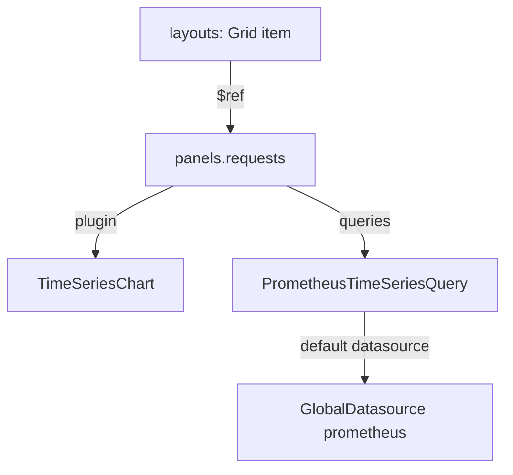

# Metrics Panels And The Dashboard Model

Before a dashboard can show logs or traces, you need to know how a dashboard is put together. Every panel in Perses follows the same pattern, whatever signal it shows. This part builds a dashboard with one metrics panel, applies it, and then takes the resource apart so the pattern is clear for every panel that follows.

## A first panel

The counter `app_requests_total` grows by one for every request the telemetry generator reports, with the labels `service_name` and `deployment_environment`. The PromQL expression `sum by (service_name) (rate(app_requests_total[5m]))` turns it into requests per second for each service. First check that the query returns data, through the default global datasource:

<!-- astrona:playground:renew -->

```sh
curl -s http://perses.localtest.me:8080/proxy/globaldatasources/prometheus/api/v1/query \
  --data-urlencode 'query=sum by (service_name) (rate(app_requests_total[5m]))' \
  | jq -r '.data.result[].metric.service_name'
```

The answer lists `checkout` and `payments`. Now put the same query in a dashboard. Save this as `dashboard-metrics-demo.yaml`:

```yaml
kind: Dashboard
metadata:
  name: metrics-demo
  project: inventory
spec:
  display:
    name: Metrics demo
  duration: 1h
  panels:
    requests:
      kind: Panel
      spec:
        display:
          name: Request rate by service
        plugin:
          kind: TimeSeriesChart
          spec: {}
        queries:
          - kind: TimeSeriesQuery
            spec:
              plugin:
                kind: PrometheusTimeSeriesQuery
                spec:
                  query: sum by (service_name) (rate(app_requests_total[5m]))
  layouts:
    - kind: Grid
      spec:
        items:
          - x: 0
            y: 0
            width: 24
            height: 8
            content:
              $ref: "#/spec/panels/requests"
```

Apply it:

```sh
percli apply -f dashboard-metrics-demo.yaml
```

Then open `http://perses.localtest.me:8080/projects/inventory/dashboards/metrics-demo` in your browser. The panel draws one line per service for the last hour (`duration: 1h`).

## The four parts of a dashboard

The dashboard spec has four fields that matter here. `panels` is a map: each key, such as `requests`, names one panel. `queries` sits inside a panel and lists what to fetch. `layouts` decides where each panel appears. `duration` is the default time range. Each panel and each query has a `plugin` with a `kind` and a `spec`:

| Field | Plugin here | Its job |
| --- | --- | --- |
| `panels.requests.spec.plugin` | `TimeSeriesChart` | The panel plugin: draws the data |
| `queries[].kind` | `TimeSeriesQuery` | The query kind: which family of data the panel expects |
| `queries[].spec.plugin` | `PrometheusTimeSeriesQuery` | The query plugin: fetches the data from one backend |

The query kind and the panel plugin must fit together. A `TimeSeriesChart` draws time series, so its queries are of kind `TimeSeriesQuery`. The query plugin decides the backend: `PrometheusTimeSeriesQuery` talks to a `PrometheusDatasource`. Because this query names no `datasource`, it uses the default `PrometheusDatasource`, the global `prometheus`.

## Layouts place panels

A panel that no layout mentions exists in the resource but never appears on the screen. A layout of kind `Grid` has `items`; each item has a position (`x`, `y`), a size (`width`, `height`) and a `content` with a `$ref`. The `$ref` is a JSON reference to the panel: `#/spec/panels/requests` means "the key `requests` under `spec.panels` of this resource". The grid is 24 columns wide, so `width: 24` fills a row and `width: 12` fills half of it.



The diagram shows the chain from the layout item to the datasource: each arrow is one field of the resource.

## When a panel is empty

An empty panel has one of three causes, and you can test them in order. Is the panel in a layout? Read `layouts` and look for its `$ref`. Does the query return data? Send it through the proxy with `curl`, as you did at the start. Does the query use the datasource you think? Read its `datasource` field, or remember that an empty field means the default of the kind.

Perses checks a dashboard against the plugin schemas when you apply it. A field that a plugin does not know, or a wrong type, makes `percli apply` fail with an error that names the field. A label that does not exist, or a datasource name that does not exist, passes that check: the problem only shows when the panel runs its query. That is why the proxy test matters.

You now know the pattern every panel follows: a panel plugin, a query of a matching kind with a query plugin, and a layout item that points at the panel. Logs follow the same pattern with different plugins.

## Common pitfalls

> [!WARNING]
> - **A panel without a layout item.** It is in the resource, but the dashboard never shows it. Every panel key needs a `$ref` in a layout.
> - **A `$ref` with a typo.** `#/spec/panel/requests` (without the `s`) points at nothing.
> - **A query kind that does not fit the panel.** A `TimeSeriesChart` needs `TimeSeriesQuery` queries.
> - **Trusting `percli apply`.** It checks the shape of the resource, not whether a label or a datasource exists. Test the query through the proxy.
