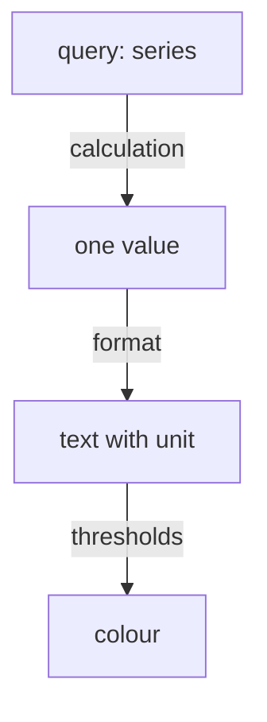

# Stat Charts, Calculations And Units

A time series chart draws every point of a series. A **stat chart** draws one number: the current request rate, the highest memory use of the hour. To get one number out of a series, the panel needs a rule for which point to pick or how to combine them. That rule is the **calculation**, and it is the first of three settings that every single-number panel shares.

## From series to one number

A query returns one or more series, and each series has many points over the time range of the dashboard. A `StatChart` reduces each series to one value in three steps, and then writes the value with a unit and a colour.



The diagram shows the steps in order: the calculation picks the value, the format writes it, and the thresholds colour it.

The `calculation` field takes one of these values: `first`, `last`, `first-number`, `last-number`, `mean`, `sum`, `min` or `max`. The default is `last`. The two `-number` variants skip points that are not numbers, such as gaps. For a request rate, `last` shows the current rate and `mean` shows the average over the time range of the dashboard.

## A first stat chart

Save this as `dashboard-numbers.yaml`. It has one `StatChart` for the total request rate:

<!-- astrona:playground:renew -->

```yaml
kind: Dashboard
metadata:
  name: numbers
  project: inventory
spec:
  display:
    name: Numbers
  duration: 1h
  panels:
    total:
      kind: Panel
      spec:
        display:
          name: Total requests per second
        plugin:
          kind: StatChart
          spec:
            calculation: last
            format:
              unit: requests/sec
              decimalPlaces: 2
            sparkline: {}
        queries:
          - kind: TimeSeriesQuery
            spec:
              plugin:
                kind: PrometheusTimeSeriesQuery
                spec:
                  query: sum(rate(app_requests_total[5m]))
  layouts:
    - kind: Grid
      spec:
        items:
          - x: 0
            y: 0
            width: 8
            height: 6
            content:
              $ref: "#/spec/panels/total"
```

Apply it:

```sh
percli apply -f dashboard-numbers.yaml
```

Open `http://perses.localtest.me:8080/projects/inventory/dashboards/numbers`. The panel shows one number with the unit `requests/sec`, and a small line behind it. The empty object `sparkline: {}` turns the small line on; without it the panel shows only the number.

## Formats and units

The `format` object writes the value. Its `unit` field decides the text: `decimal` for plain numbers, `percent` for values from 0 to 100, `percent-decimal` for values from 0 to 1, `bytes`, `seconds`, `milliseconds`, and throughput units such as `requests/sec`. The field `decimalPlaces` sets how many digits follow the decimal point, and `shortValues: true` writes large numbers as `1.2K` or `3.4M` for the units that allow it.

Change `calculation` from `last` to `max`, apply the file again, and reload the page. The number changes to the highest rate within the time range. Then change the unit to `decimal` and compare: the number stays the same and only the text around it changes. The unit changes how the value is written. It does not change the query, so a query that returns seconds must use a time unit, not a byte unit.

## Colour with thresholds

The `thresholds` setting colours the value. Each step has a `value` and a `color`, and a step applies from its value upward. The `defaultColor` applies below the first step. Add this block next to `format` in the stat panel:

```yaml
            thresholds:
              defaultColor: green
              steps:
                - value: 5
                  color: orange
                - value: 10
                  color: red
```

Apply the file again. The number is green below 5, orange from 5 up to 10 and red from 10 up. The colour lets the reader see a problem without reading the number, which is why single-number panels almost always have thresholds.

You now have the three shared settings: calculation, format and thresholds. The next panel shows the same number as a position on a dial, and it needs one more idea: what the top of the dial is.

## Common pitfalls

> [!WARNING]
> - **Leaving the default `last` when you mean an average.** A stat that shows the last point jumps with every refresh; choose `mean` for a calmer number.
> - **Using `percent` for a ratio between 0 and 1.** The value `0.4` is shown as `0.4%`. Use `percent-decimal`.
> - **Thresholds out of order.** Write the steps from the lowest value to the highest.
