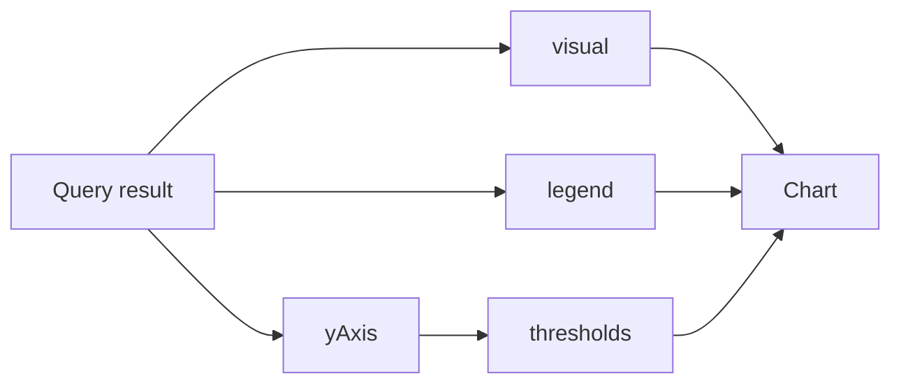

# Time Series Chart Options

The `TimeSeriesChart` is the panel you will build most often. Its spec has five groups of settings, and each answers one reader question: which line is which (`legend`), what do the numbers mean (`yAxis`), how does the line look (`visual`), when is it too high (`thresholds`), and which colour does each query get (`querySettings`). This part sets each group on one chart.

## The five groups

| Field | What it controls |
| --- | --- |
| `legend` | Where the legend is, whether it is a list or a table, and which values the table shows |
| `yAxis` | Whether the axis is shown, its label, its format and its minimum and maximum |
| `visual` | Line or bars, line width, area under the line, stacking and gaps |
| `thresholds` | Steps drawn as lines on the chart, in the same form as on a stat chart |
| `querySettings` | A colour for each query, chosen by the index of the query |



The diagram shows how one query result feeds the chart: the visual settings draw the lines, the axis puts them on a scale, the thresholds mark that scale, and the legend names the lines.

## A first tuned chart

Save this as `dashboard-traffic.yaml`. It has one panel with a legend table on the right, an axis in requests per second and a filled line:

<!-- astrona:playground:renew -->

```yaml
kind: Dashboard
metadata:
  name: traffic
  project: inventory
spec:
  display:
    name: Traffic
  duration: 1h
  panels:
    rate:
      kind: Panel
      spec:
        display:
          name: Requests per second
        plugin:
          kind: TimeSeriesChart
          spec:
            legend:
              position: right
              mode: table
              values:
                - last
                - max
            yAxis:
              format:
                unit: requests/sec
                decimalPlaces: 1
              min: 0
            visual:
              display: line
              lineWidth: 2
              areaOpacity: 0.2
            thresholds:
              mode: absolute
              defaultColor: green
              steps:
                - value: 10
                  color: red
        queries:
          - kind: TimeSeriesQuery
            spec:
              plugin:
                kind: PrometheusTimeSeriesQuery
                spec:
                  query: sum by (service_name) (rate(app_requests_total[5m]))
                  seriesNameFormat: "{{service_name}}"
  layouts:
    - kind: Grid
      spec:
        items:
          - x: 0
            y: 0
            width: 24
            height: 8
            content:
              $ref: "#/spec/panels/rate"
```

Apply it and open the dashboard:

```sh
percli apply -f dashboard-traffic.yaml
```

The dashboard is at `http://perses.localtest.me:8080/projects/inventory/dashboards/traffic`. The legend is a table on the right with one row for each service, and two columns: the last value and the maximum. The y axis starts at 0 and reads in requests per second. The line has a faint area under it, and a red line marks 10 requests per second.

## The legend

The legend has three fields. `position` is `bottom` or `right`. `mode` is `list`, which shows names only, or `table`, which shows names and values. `values` lists the calculations a table shows as columns: the same names as on a stat chart, such as `last`, `mean`, `min` and `max`. A table legend turns the chart into a small report, because the reader can read exact numbers without hovering. When the chart has many series, the table is the better choice because a list of long names fills the chart.

## The y axis

The axis `format` is the same object as on a stat chart: a `unit` and `decimalPlaces`. Setting the unit here is what makes the tick labels and the tooltip say `req/s` instead of a bare number. `min` and `max` fix the ends of the axis. Without `min`, Perses picks the lowest value in view, which makes a small change look large. With `min: 0`, a change is drawn at its true size. The field `show` hides the axis, and `label` writes a title next to it.

## Line style

`visual.display` is `line` or `bar`. `lineWidth` sets the thickness. `areaOpacity` fills the area under each line, from `0` (none) to `1` (solid). `lineStyle` is `solid`, `dashed` or `dotted`. `pointRadius` draws points on the line. `connectNulls: true` draws a line across gaps where a series has no data, and the default leaves a gap, which is honest about missing data. `stack` is `none`, `all` or `percent`. With `all`, series are drawn on top of each other, so the top line is the total; with `percent`, each series is its share of the total.

## Thresholds on a chart

The `thresholds` object is the same as on a stat chart: a `mode` of `absolute` or `percent`, a `defaultColor` and a list of `steps`. On a time series chart, each step is drawn as a horizontal line at its value. The reader sees how far the line is from the limit without reading any number.

## Colour for a query

When one chart has two queries, `querySettings` gives each a colour. Each entry names a `queryIndex` (the first query is `0`), a `colorMode` of `fixed` or `fixed-single`, and a `colorValue`:

```yaml
            querySettings:
              - queryIndex: 0
                colorMode: fixed-single
                colorValue: "#2f9e44"
```

Use `fixed-single` for a query that returns one series, and `fixed` for a query that returns several series, which then get shades of the colour.

## Common pitfalls

> [!WARNING]
> - **Leaving the axis minimum open on a rate.** A rate that changes between 9.8 and 10.1 fills the whole chart. Set `min: 0` unless you want to show a small change.
> - **A table legend without `values`.** The table has only the name column. List the calculations you want.
> - **Stacking series that are not parts of a total.** Stacking adds the lines together. Use it for parts of a whole, not for a latency of two services.
