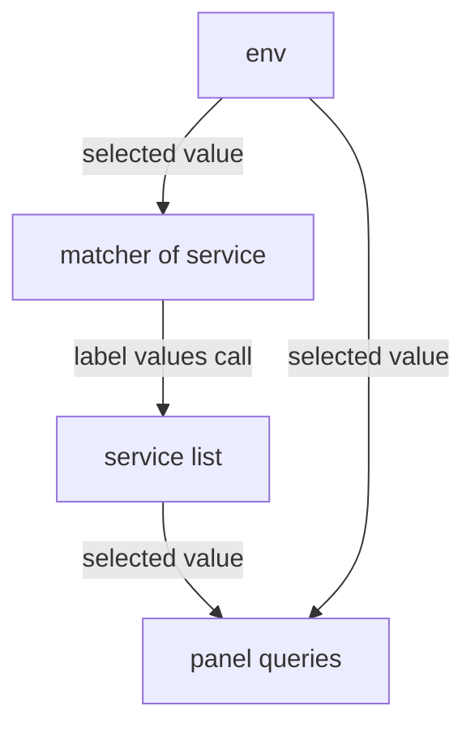

# Variables That Depend On Other Variables

A service dropdown that lists every service in every environment lets the reader pick `payments` in `staging`, a combination that does not exist, and then stare at empty panels. The fix is a **cascade**: the service list reads the selected environment and offers only the services that run there. This part builds that cascade and tests it without a browser.

## Two lists, one question each

The cascade needs two variables. The first, `env`, lists the environments; it depends on nothing. The second, `service`, lists the services, but only on series of the selected environment. Both read label values from Prometheus, so both are `PrometheusLabelValuesVariable`s. The difference is the matcher: the `service` matcher uses `$env`.

Before you write the variables, ask Prometheus the two questions yourself. First the environments:

<!-- astrona:playground:renew -->

```sh
curl -s -G http://perses.localtest.me:8080/proxy/globaldatasources/prometheus/api/v1/label/deployment_environment/values \
  --data-urlencode 'match[]=app_requests_total' | jq -c '.data'
```

The answer is `["production","staging"]`. Now the services of `staging`, with the environment written into the matcher the way Perses will write it:

```sh
curl -s -G http://perses.localtest.me:8080/proxy/globaldatasources/prometheus/api/v1/label/service_name/values \
  --data-urlencode 'match[]=app_requests_total{deployment_environment="staging"}' | jq -c '.data'
```

The answer is `["checkout"]`: only `checkout` runs in `staging`. With `production` written in instead, the answer is `["checkout","payments"]`. These two calls are exactly what the dashboard will do, which makes them the quickest test of a cascade.

## The cascade in a dashboard

Save this as `dashboard-cascade-demo.yaml`:

```yaml
kind: Dashboard
metadata:
  name: cascade-demo
  project: inventory
spec:
  display:
    name: Cascade demo
  duration: 1h
  variables:
    - kind: ListVariable
      spec:
        name: env
        display:
          name: Environment
          hidden: false
        allowAllValue: false
        allowMultiple: false
        sort: alphabetical-asc
        plugin:
          kind: PrometheusLabelValuesVariable
          spec:
            labelName: deployment_environment
            matchers:
              - app_requests_total
    - kind: ListVariable
      spec:
        name: service
        display:
          name: Service
          hidden: false
        allowAllValue: false
        allowMultiple: false
        sort: alphabetical-asc
        plugin:
          kind: PrometheusLabelValuesVariable
          spec:
            labelName: service_name
            matchers:
              - app_requests_total{deployment_environment="$env"}
  panels:
    requests:
      kind: Panel
      spec:
        display:
          name: Requests of $service in $env
        plugin:
          kind: TimeSeriesChart
          spec: {}
        queries:
          - kind: TimeSeriesQuery
            spec:
              plugin:
                kind: PrometheusTimeSeriesQuery
                spec:
                  query: sum(rate(app_requests_total{deployment_environment="$env", service_name="$service"}[5m]))
  layouts:
    - kind: Grid
      spec:
        items:
          - x: 0
            y: 0
            width: 24
            height: 8
            content:
              $ref: "#/spec/panels/requests"
```

Apply it:

```sh
percli apply -f dashboard-cascade-demo.yaml
```

Then open `http://perses.localtest.me:8080/projects/inventory/dashboards/cascade-demo`. With `production` selected, the service list holds both services. Switch to `staging`, and Perses loads the service list again: it now holds only `checkout`.

## How Perses resolves the chain

Perses works through the `variables` list in order. It loads the values of `env`, picks the selected one, writes it into the matcher of `service`, and only then loads the values of `service`. When the reader changes `env`, Perses repeats the steps from `service` on.



The diagram shows the chain: the environment feeds the service list, and both feed the panels.

Because the order of the list decides the order of the work, a variable must come after every variable it uses. Put `service` before `env`, and Perses has no value for `$env` when it loads the service list, so the list is wrong or empty.

The demo uses single values on purpose. With `allowMultiple` on `env`, the matcher would need `deployment_environment=~"$env"`, for the same reason any query needs `=~` with several values. A cascade can be as long as you need: a third variable, for example an instance list, could use both `$env` and `$service` in its matcher.

You can now build a service list that follows the environment. The panel in the demo only shows metrics. Logs and traces name the same labels differently, and the next step is to write one selection into all three.

## Common pitfalls

> [!WARNING]
> - **A matcher without `$env`.** The service list ignores the environment and offers combinations that do not exist.
> - **The dependent variable first.** `service` before `env` means `$env` has no value when the service list loads.
> - **`=` with a multi-value parent.** If `env` allows several values, the child matcher needs `=~`.
> - **Testing only in the browser.** The label values call with the value written in by hand shows the exact list a cascade produces.
