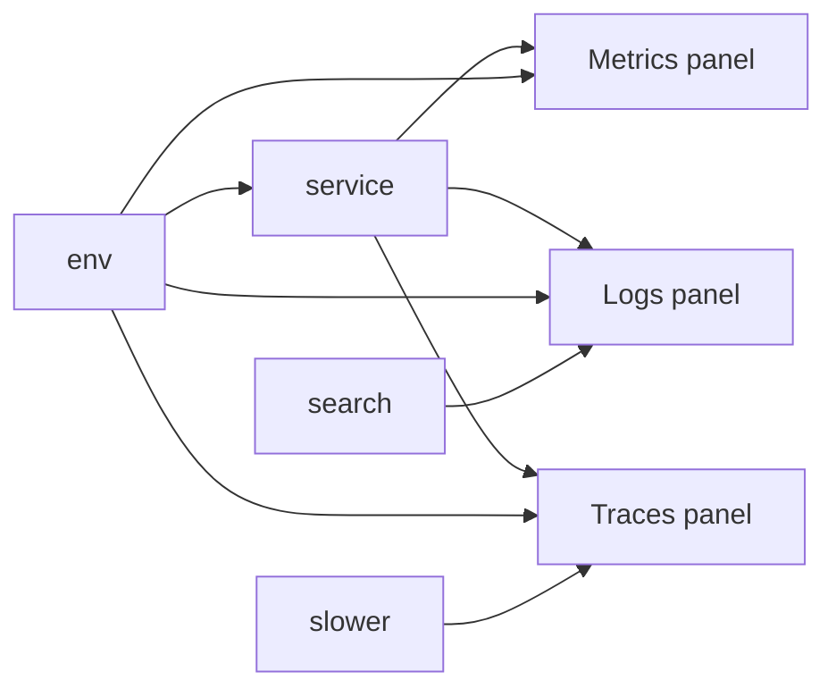

# Debugging A Variable Cascade

A dashboard with five variables and three backends fails in ways that look alike: an empty table, an empty dropdown, an error in a panel. This part gives a fixed order of checks. Each check tests one link of the chain, so the first failing one names the cause.

## The chain



The diagram shows that `service` depends on `env`, and every panel depends on one or more variables. A mistake in `env` shows up in every other box, so always check from the left.

## Check one: the order

Variables are resolved in the order of `spec.variables`. A variable that uses another must come after it. Print the order and the dependencies of a dashboard:

<!-- astrona:playground:renew -->

```sh
percli get dashboard explorer -o json | jq -r '
  .spec.variables[] | "\(.spec.name): \(.spec.plugin.spec | tostring | [match("\\$[a-z_]+"; "g").string] | unique | join(" "))"'
```

Each line shows a variable and the variables its spec names. If `service` names `$env`, then `env` must be printed above it.

## Check two: each list by hand

Run the request each list variable sends, with the values of the earlier variables written in. For `env`:

```sh
curl -s -G http://perses.localtest.me:8080/proxy/globaldatasources/prometheus/api/v1/label/deployment_environment/values \
  --data-urlencode 'match[]=app_requests_total' | jq -r '.data[]'
```

For `service`, write the environment you picked into the matcher. An empty answer here means the variable is correct and the data does not exist for that choice. A non-empty answer means the problem is further right.

## Check three: each panel query by hand

Write the variable values into the query text and send it. For the logs panel with both environments and both services:

```sh
curl -s -G http://perses.localtest.me:8080/proxy/globaldatasources/loki/loki/api/v1/query_range \
  --data-urlencode 'query={deployment_environment=~"(production|staging)", service_name=~"(checkout|payments)"} |= "order"' \
  | jq '.data.result | length'
```

Do the same with a single value, with `All` written as `.*`, and with an empty search. If one of these cases fails and the others work, the text a variable writes is wrong for that case. This is the most common cause of a dashboard that works for the author and fails for the reader.

## Check four: the names

A query reads a variable by its `name` field, and the name is case-sensitive. `$Service` is not `$service`. In TraceQL the attribute names also differ from the label names: `deployment_environment` in PromQL and LogQL is `resource.deployment.environment` in TraceQL.

## Check five: the scope

If a variable shows values you did not define, a project `Variable` or a `GlobalVariable` with the same name may hide yours, or yours may hide theirs. The smallest scope wins. List the project variables with `percli get variable` and the global ones with `percli get globalvariable`.

## A table of symptoms

| Symptom | First suspect |
| --- | --- |
| A dropdown is empty | The matcher of its own query, or the variable before it |
| One panel is empty, the others work | The query text of that panel for this case |
| Empty only with several values selected | `=` used where `=~` is needed |
| Empty only with `All` | `customAllValue` missing or wrong |
| The panel shows an error about the query | A special character from a text variable |
| The dropdown shows the wrong values | A variable of the same name at a smaller scope |

## Common pitfalls

> [!WARNING]
> - **Testing only the case you pick yourself.** Test none, one, many and `All` before you share a dashboard.
> - **Changing two things at once.** Change one variable, reload, and look; the cause of a new failure is then the last change.
> - **Fixing a panel when the variable is wrong.** An empty list in front of three empty panels is one problem, not four.
